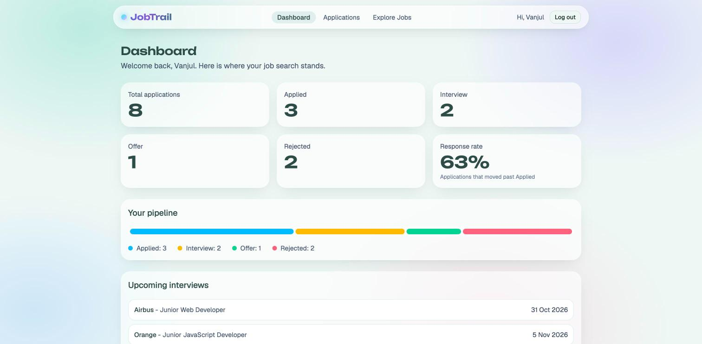
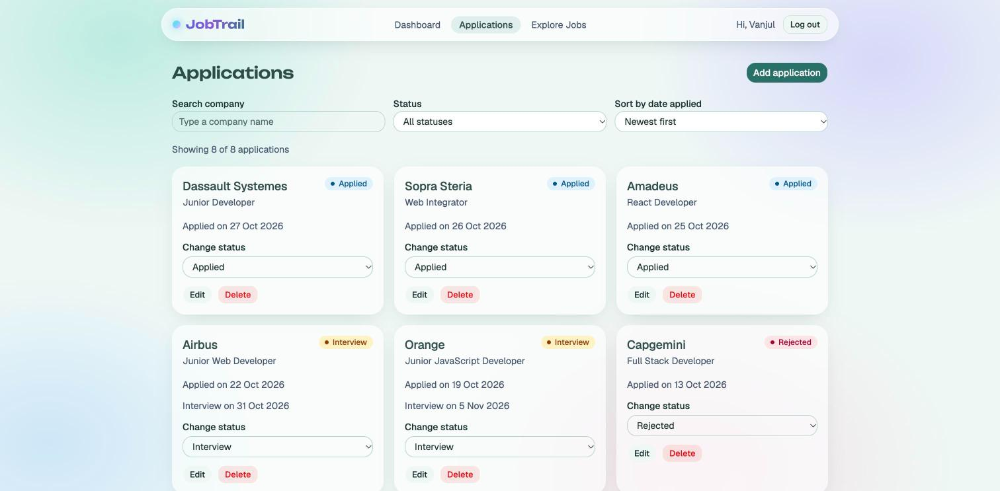
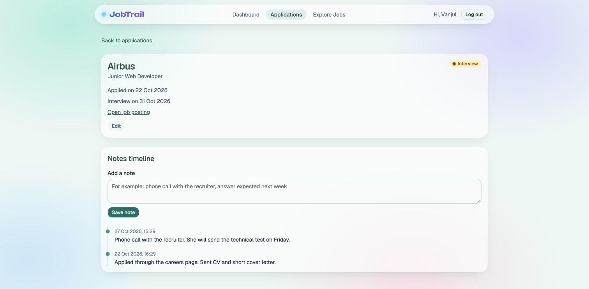
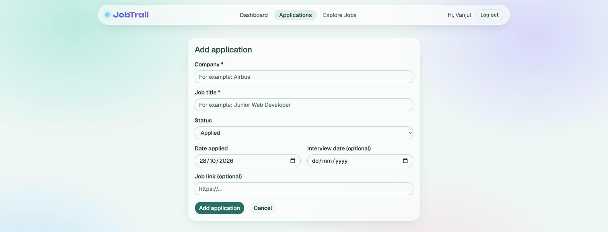
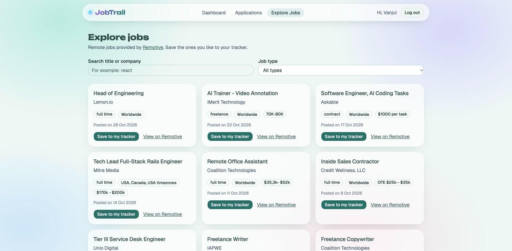
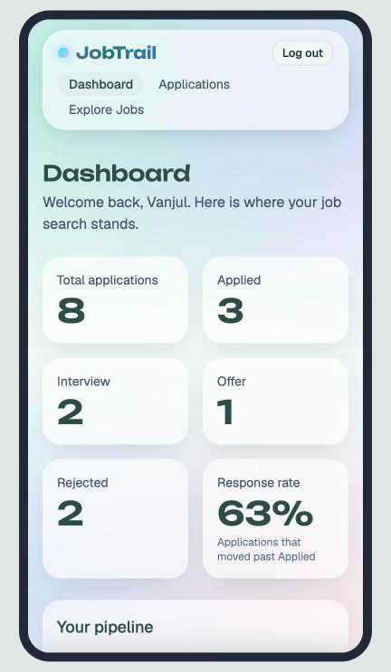

# JobTrail

A small app to keep track of the jobs I apply for. I can add applications, move them through the stages, write dated notes, see my numbers on a dashboard and find new remote jobs to save.

This is my Milestone 3 project (React) for the WSCube Tech Full Stack Mentorship. It is made with React, with all the data kept in the browser.

- **Name:** Vanjul Thakur
- **Batch:** May 2026
- **Option:** B, Job Application Tracker

## Links

- Live site: https://jobtrail-snowy.vercel.app
- Code: https://github.com/vanjulT/jobtrail

The login is a demo: there is no password. Type any name and you are in.

## What it does

- Add, edit and delete applications (company, job title, status, dates, link).
- Move an application through the stages Applied, Interview, Offer and Rejected, directly from its card.
- The dashboard shows a count for each stage, a coloured pipeline bar, the response rate and the upcoming interviews.
- Search by company, filter by status and sort by date.
- Each application has a detail page with a timeline of dated notes.
- The Explore Jobs page loads real remote jobs from the Remotive API, with a "Save to my tracker" button.
- Loading placeholders, error messages with a "Try again" button, and designed empty states.
- Your data stays after a refresh, because it is saved in LocalStorage.
- It works on phones and on desktop.

## Screenshots

### Login


### Dashboard



### Applications



### Application detail with notes



### Add application



### Explore jobs



### On a phone



## Component tree

```
main.jsx
└── BrowserRouter
    └── AuthProvider              who is logged in (Context)
        └── ApplicationsProvider  all the applications (Context)
            └── App               the routes
                └── Layout
                    ├── Navbar
                    └── <Outlet />  the current page
                        ├── LoginPage
                        └── ProtectedRoute  sends visitors to /login if nobody is logged in
                            ├── DashboardPage
                            │   ├── StatCard (x6)
                            │   ├── PipelineBar
                            │   └── UpcomingInterviews
                            ├── ApplicationsPage
                            │   ├── FilterBar
                            │   ├── ApplicationCard (one per application)
                            │   │   └── StatusBadge
                            │   └── EmptyState
                            ├── ApplicationFormPage      add and edit
                            │   └── ApplicationForm
                            ├── ApplicationDetailPage
                            │   ├── StatusBadge
                            │   ├── AddNoteForm
                            │   └── NotesTimeline
                            └── ExploreJobsPage
                                ├── JobCard (one per job)
                                └── JobCardSkeleton (while loading)
```

## Routes

| Address | Page | Protected |
| --- | --- | --- |
| `/login` | Login | No |
| `/` | Dashboard | Yes |
| `/applications` | Applications list | Yes |
| `/applications/new` | Add application | Yes |
| `/applications/:id` | Application detail (dynamic route) | Yes |
| `/applications/:id/edit` | Edit application | Yes |
| `/explore` | Explore Jobs | Yes |

## Where the state lives

- **Context:** the list of applications (`ApplicationsContext`) and the logged-in name (`AuthContext`). Many pages need them, so they live above the routes and no props have to be passed down through every level.
- **Local state (`useState`):** the search text and the filters, the form fields and the note text. Only one component needs each of these, so they stay inside it.
- **Lifting state up:** the search text, status filter and sort order live in `ApplicationsPage`. `FilterBar` only shows them and reports changes through props.

## Custom hooks

| Hook | Job |
| --- | --- |
| `useLocalStorage` | Works like `useState`, but also saves the value in LocalStorage |
| `useRemoteJobs` | Loads the jobs from Remotive and gives back the jobs, the loading state, the error and a reload function |
| `useCountUp` | Counts a number up from 0, for the dashboard |

## The API

I use the [Remotive](https://remotive.com) jobs API. It does not need a key. It always returns the same small list of jobs and ignores search options, so the search and the job type filter run in the browser. Remotive asks to link back to each job and to name them as the source, so each card has a "View on Remotive" link. They also ask not to call the API too often, so the jobs are kept in memory while the app is open.

## Things I used

- Components with props, and lists with stable keys (the id, not the position)
- `useEffect` with a dependency list, and a cleanup that cancels the request (`AbortController`)
- `useMemo` for the filtered list and the dashboard numbers
- React Router with a shared layout, a dynamic route and a protected route
- shadcn/ui components, and Tailwind CSS v4 for the styling
- CSS animations that respect "reduce motion" in the system settings

## Run it yourself

```
git clone https://github.com/vanjulT/jobtrail.git
cd jobtrail
npm install
npm run dev
```

Then open the address shown in the terminal.

## How I worked

Each part has its own branch and pull request: setup, layout and state, the form, the list and filters, the detail page, login, the Explore Jobs page, the design, and the polish for phones and Vercel.